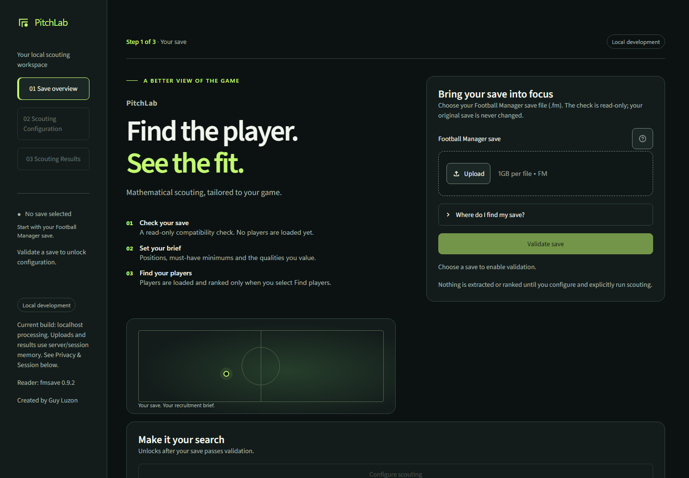
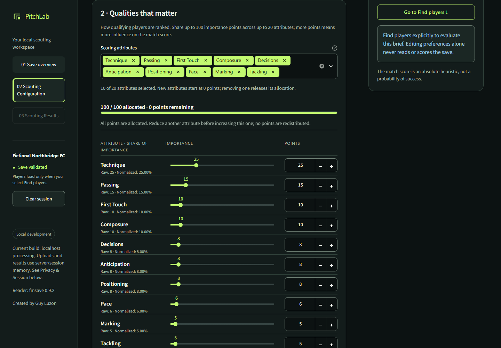
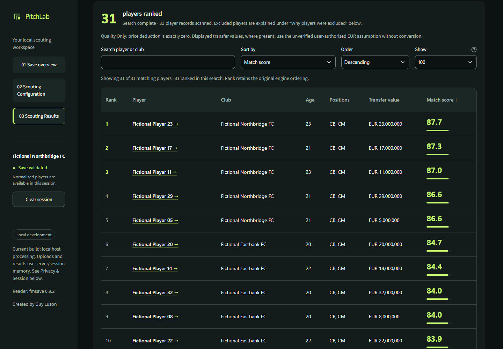
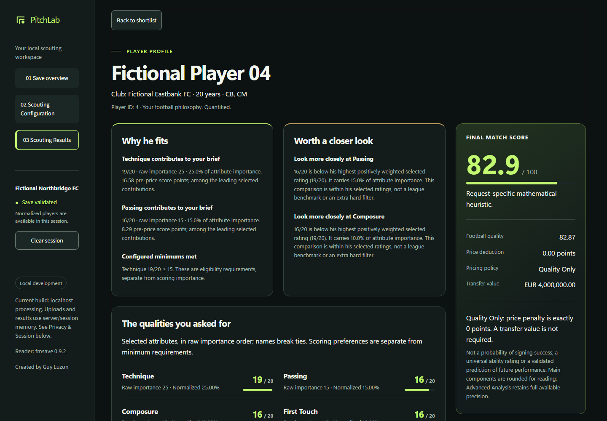

# PitchLab — Find the player. See the fit.

**Mathematical scouting, tailored to your game.**

Football Manager gives you thousands of players and plenty of ratings. Finding the right fit still means deciding which qualities matter to *your* team.

PitchLab turns those priorities into a personalized player ranking. Define who qualifies, choose what matters most, and see why each player fits your recruitment brief.

**Created by Guy Luzon**

## Join the closed beta waitlist

PitchLab is preparing a **free, invitation-only closed beta**. The beta is **not publicly available yet**; access will be offered by invitation.

**[Join the free closed beta waitlist](https://docs.google.com/forms/d/e/1FAIpQLSfLi4yWDYLnSig5TSiR0Mjir2EllGWryFnjp4EgvKJ1OkrKwg/viewform)**

## 1. Start with your save

Begin with a read-only compatibility check, then build your scouting brief. Selecting a file does not automatically run a search.

## 2. Define your kind of player

Use positions, age limits and minimum attribute requirements as **hard filters**. Then assign **weighted attribute priorities** to decide how eligible players are ranked. Balance current ability against potential to reflect the player you need now and the development you value.

## 3. Find the fit

Explore a sortable shortlist with prominent match scores and player details. Each score comes from a deterministic mathematical model tailored to your brief, on an absolute **0–100 heuristic scale**. It is **not a probability of success** or a percentile within the player pool.

Choose **Quality Only** for no price deduction, or use optional **price-aware scoring** to include a transparent deduction alongside football quality.

## 4. Understand the score

Open a player profile to inspect strengths, concerns, selected attributes, football quality and any price deduction. The explanation connects the result to your own priorities, so you can understand the ranking and make your own decision.

## Current scope

PitchLab is in active development. Current scouting focuses on **outfield players**; dedicated goalkeeper scouting is planned. FM27 integration remains **experimental**, and compatibility checks do not independently validate every field's meaning. Full-data evaluation can reveal information normally hidden during gameplay.

Experimental price-aware evaluation treats unchanged extracted values as EUR; internal save-value units have not been independently verified. No currency conversion is applied.

All screenshots show the actual application using **fictional demonstration players and clubs**. They contain no private save data and illustrate the local development experience, not a hosted public service.

This repository is a **public product showcase**. Application source code, datasets and private saves are not distributed here.

## Unofficial project

PitchLab is an independent, unofficial project. It is not affiliated with, endorsed by or sponsored by Sports Interactive or SEGA. Football Manager, Sports Interactive and SEGA names and marks remain the property of their respective owners.
